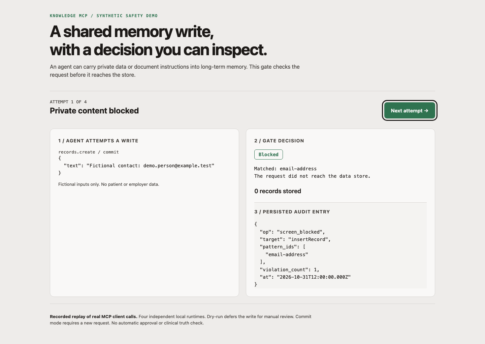

# knowledge-mcp

**A testable write boundary for AI agents that share long-term memory.** For engineers and product teams evaluating agent controls, including clinical AI platforms. This is a small, local prototype with inspectable tests, not a clinical system or a compliance certification.

## The problem

An agent can copy private information, a false claim or instructions hidden in a document into shared memory. Later agents may retrieve that entry and treat it as reliable context. A mistaken write can outlive the conversation that produced it.

This project puts one gate between the agent and the store. It makes the write decision visible and lets an operator defer writes for review. It cannot determine whether a clinical statement is true.

## What it does

- Screens every store-write argument, including nested fields, keys, numbers and file paths. The example deny-list checks six patterns: email, US phone, SSN format, birth-date labels, record-number labels and payment-card format.
- Checks raw and normalized text, including full-width characters and invisible-character bypasses. Unreadable, circular, oversized or unsupported values fail closed.
- Adds small heuristics for instruction overrides, system/developer role spoofing and bulk memory export instructions. Explicitly untrusted provenance is refused. These are literal checks, not an injection classifier.
- Records a timestamp, store operation, outcome and reason identifiers for allowed, blocked and deferred writes. Gate-decision entries contain no submitted values or excerpts.
- Offers **dry-run mode** for manual review. Safe requests are screened and deferred. Records and files stay unchanged, while the audit decision is still written. An operator must resubmit an approved request in commit mode.
- Stores source provenance on records: caller-supplied source and source date, plus the server's recording timestamp. Older callers still work. Unknown source dates stay unknown. Provenance is traceability, not verification.



The [recorded replay](docs/media/safety-demo.html), [static screenshot](docs/media/safety-demo.png) and [raw transcript](docs/media/safety-demo.json) use real in-process MCP client calls with fictional inputs. The [demo script](scripts/safety-demo.mjs) shows private content blocked, a document instruction blocked, a safe request deferred and a reviewed request resubmitted. The four attempts use independent runtimes. No model, network call or paid API is required.

## How it was tested

The existing evaluation is unchanged: **324 planted cases across 10 write tools**, using six synthetic patterns in every existing string argument, both replacing and appending to valid values. Calls go through an MCP client and server. The test also checks ten benign calls and has a canary that catches writes when the guarded store is bypassed.

A new **60-case synthetic held-out set** was generated from seed `20261031` and committed with its generator, SHA-256 and baseline result before implementation. Separate development tests drove the changes. The implementation was committed before the after run and was not tuned on the held-out results. The same author designed the challenge families and controls, so this is not an independent benchmark.

## Results and limits

Before means the public `main` snapshot at `9dc0ac6`. The old tests and their original result are preserved.

| Measured outcome | Before | After |
| --- | ---: | ---: |
| Existing planted values persisted | 0/324 | 0/324 |
| Existing benign controls falsely blocked | 0/10 | 0/10 |
| Held-out risky writes blocked | 10/40 | 30/40 |
| Held-out risky writes allowed, misses | 30/40 | 10/40 |
| Held-out benign writes falsely blocked | 0/20 | 5/20 |
| Held-out total blocked / allowed | 10 / 50 | 35 / 25 |

The 324 original cases include 312 rejected responses and 12 harmless “no replacement” responses. Of those cases, 192 reach a direct screening block. The rest are stopped by existing schema, path or operation checks. Calling all 324 direct gate detections would overstate the result.

The new controls reduce allowed risky writes on this set, at the cost of five false blocks. **The gate still allows encoded instructions and plausible false clinical claims.** It also blocks benign security lessons that quote an attack phrase. The [full evaluation](docs/evaluation/README.md) publishes every outcome and concrete misses. Repeated variants within a family do not establish broad attack coverage.

Other limits matter for a platform reader:

- Pattern checks miss names, street addresses, novel attacks and many identifier formats. The example patterns are US-oriented. A matching value rejects the whole request, including benign contact information.
- Source and trust labels are caller assertions. An agent can omit or mislabel them. There is no authenticated source attestation or clinical fact checking. Use dry-run for uncertain material.
- Dry-run defers all writes in that runtime, not just a selected risk class. It has no approval queue or durable approval token. Seeding is skipped in dry-run. Loaded data must still pass the current gate.
- Gate-decision audit entries are value-free. Older memory-operation audit entries include already-screened file paths and sizes. Validation errors that never reach the guarded store are not audited. Audit records share the store file, have no tamper protection and are not transactionally committed with the data change.
- The store is in memory or one JSON file, for one process without locking. The stdio server trusts its host. `OWNER_ID` is a configured label, not an authenticated user.
- The browser helper shares text screening but has no dry-run or server audit persistence. It is tested with a fake database client. A modified page can bypass browser checks, so database enforcement is still needed.
- This is synthetic testing of deterministic controls, not a patient study, production deployment or proof of clinical safety.

## Run the demo and tests

Requires Node 20 or later. This comparison was run with Node 24.14.1 and npm 11.11.0 on macOS.

```sh
npm ci
npm test
npm run check
npm run demo:safety
npm run eval:legacy
npm run eval:heldout
```

The original `npm run demo` remains available. It runs seven benign writes and seven planted attempts with zero planted values left in the store.

To start an MCP server in dry-run mode:

```sh
KNOWLEDGE_WRITE_MODE=dry-run npm start
```

Reads still work. Blocked writes return a screening error. Safe writes return a dry-run deferral error so an agent cannot mistake a preview for a successful save. To make a reviewed write, start a commit-mode runtime and resubmit the request. This does not bypass screening.

Example additive provenance input for `records.create`, `decisions.log` or `inbox.capture`:

```json
{
  "text": "Fictional team reviews every draft.",
  "provenance": {
    "source": "synthetic-handbook-v2",
    "observedAt": "2026-10-30",
    "trust": "asserted"
  }
}
```

New records receive `recordedAt` from the server clock. Without supplied provenance, the source falls back to the writer label, the source date is null and trust is unspecified. Memory files record their writer and recording date, with a null source date. Existing rows are not retroactively given a source. Reads expose record provenance alongside the content.

A reviewer can read the audit in the JSON snapshot or through the embedded runtime's `store.listAudit()`. For example, the demo persists this decision:

```json
{
  "op": "screen_blocked",
  "target": "insertRecord",
  "pattern_ids": ["instruction-override"],
  "violation_count": 1,
  "at": "2026-10-31T12:00:00.000Z"
}
```

A matching request never reaches the raw write method. A passing dry-run uses `write_deferred`, and a completed store write uses `write_allowed`. These events describe store operations rather than authenticated agent identities. An allowed operation can be a no-op when no matching row exists.

## Technical detail

The runtime is `MCP tools → record/file logic → guarded store → shared screening function → raw store`. Tools and seeding receive only the guarded store. Every raw method must be classified as read or write, or startup fails. The registry test fails if a registered tool lacks a fixture. The browser helper imports the same pure screening module.

There are 17 existing tools: seven reads and ten writes. Their existing input fields and output behavior are preserved, with optional provenance fields on three tools and additive provenance in record reads. The resource is `knowledge://records/recent-decisions`. No new daemon, queue or authority is introduced.

The shared screening code applies the six configurable deny-list patterns plus four fixed policy checks. `patternIds` continues to identify the configured deny-list. `policyIds` lists the added checks. A missing, empty or invalid deny-list prevents startup. Data loaded from disk is re-screened against current policy, so stricter checks can refuse an older store at startup. Make a reviewed copy before changing policy on real data.

MCP host configuration:

```json
{
  "mcpServers": {
    "knowledge": {
      "command": "node",
      "args": ["/absolute/path/to/knowledge-mcp/src/index.js"],
      "env": {
        "KNOWLEDGE_STORE_PATH": "/absolute/path/to/store.local.json",
        "KNOWLEDGE_WRITE_MODE": "dry-run"
      }
    }
  }
}
```

| Environment variable | Default | Effect |
| --- | --- | --- |
| `KNOWLEDGE_WRITE_MODE` | `commit` | `commit` or `dry-run`, invalid modes refuse startup |
| `KNOWLEDGE_STORE_PATH` | unset | Optional JSON persistence, including audit decisions |
| `KNOWLEDGE_SEED` | `data/seed.json` | Synthetic seed on empty commit-mode stores, `none` disables |
| `DENY_LIST_PATH` | example config | Configurable privacy deny-list |
| `OWNER_ID` | `local-owner` | Configured owner label on records and files |

For the browser helper, import `createWebClient` from `knowledge-mcp/web` and supply an existing supabase-js client and deny-list. It refuses service-role, secret or unreadable keys. No hosted database schema or row-level security policy ships here.

## History and verification

Built May to October 2026 over 71 commits in a private repository. This is a cleaned public snapshot because the private history contains personal notes and configuration. The original private-version probe found 7 unchanged writes, 3 masked writes and one blocked write that leaked surrounding text to audit across 11 probes. That historical observation is separate from the public-main comparison above.

See [verification evidence](docs/evaluation/VERIFICATION.md) for RED-first failures, control and candidate commands, exit codes, visual checks and remaining limits. See [media reproduction](docs/media/README.md) for the recording process.

MIT, Copyright (c) 2026 Kevin Madden. All committed data is fictional or synthetic.

## Write gate console

Run the local console with Node 20 or newer:

```sh
npm ci && npm run console
```

Open **http://127.0.0.1:4317**. Run the scripted Atlas session or advance one write at a time. All content is synthetic. The console calls the actual record library and guarded store with the bundled deny list. Outcomes and rule IDs come from gate audit receipts.

- **Attempted writes** shows the tool, input, outcome and rule.
- **Approval queue** holds screening-passed writes in dry-run mode. Approve resubmits through the real commit gate. Reject leaves the record unwritten.
- **Audit log** joins gate receipts to synthetic source and observed-date assertions. Execution timestamps are real. Human rejection entries are console events.
- **Red-team lab** independently replays injection and untrusted-document cases, including after the main session ends.

Use Theme to switch light and dark. Reset starts a new empty session. One in-memory session is shared by tabs connected to this local server and disappears on restart. This is a synthetic demonstration, with no authentication or durable approval queue. It binds to loopback and uses no model, external service or private data. `PORT=4318 npm run console` selects another port.

Screenshots and the short flow GIF are in [docs/media](docs/media/README.md). Verification, control results and known limits are recorded in [docs/console/VERIFICATION.md](docs/console/VERIFICATION.md).
