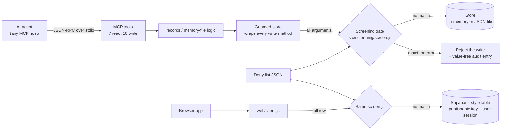

# knowledge-mcp

An MCP server that gives AI agents read and write access to a shared knowledge store. Every write passes through one screening gate that fails closed.

## Problem

Agents with long-term memory write down what they hear. If a conversation includes an email address, a phone number or a record number, the agent can save it into a store that other agents and sessions will read later. Teams building agent platforms need a write boundary they can reason about: one rule, applied the same way on every path, with tests that fail when a new path skips it.

This repo is that boundary, kept small. It covers the store and the browser write client, and the screening function they share.

## How it works



- **Tools.** `records.list`, `records.get`, `records.create`, `records.pin`, `decisions.log`, `inbox.recent`, `inbox.search`, `inbox.capture`, `inbox.capture_quick`, `inbox.buckets`, `inbox.route_suggest`, and six memory-file tools shaped after the commands of Anthropic's memory tool (`memory.view`, `create`, `str_replace`, `insert`, `delete`, `rename`). There is also one resource, `knowledge://records/recent-decisions`. Each tool declares `access: "read"` or `"write"`, and the server publishes that as the MCP `readOnlyHint`.
- **Screening gate** (`src/screening/screen.js`). It walks the whole value: every string, every object key, and every number as text. It checks each one against the deny-list, both raw and after Unicode NFKC normalization with invisible characters removed. It returns `{ ok: true }` only if nothing matched and nothing went wrong. Any other case is a rejection that names the field and the pattern id, never the matched text. The file has no Node imports, so the browser client uses the same file.
- **Guarded store** (`src/store/guarded-store.js`). The raw store sorts its methods into `READ_METHODS` and `WRITE_METHODS`. The guarded store passes reads through. It wraps each write method so that the method's full argument list is screened before the raw method runs. If the raw store has a method in neither list, the guarded store refuses to build and the server does not start. Tools, record logic, memory-file logic and seeding only ever get the guarded store.
- **Store.** In-memory by default, seeded from `data/seed.json` (synthetic). Set `KNOWLEDGE_STORE_PATH` to persist it to a JSON file. Data loaded from that file is screened before the server serves anything.
- **Browser write client** (`web/client.js`). Three methods (`captureToInbox`, `writeDecision`, `writeAnonymousSignal`) that end in one `insertScreened()` function. It takes a supabase-js client the app already created and refuses to wrap a client whose key is a service-role key, a secret key, or one whose role it cannot read.

## Evidence

All runs on 2026-10-30, Node 24.14.1, macOS.

- `npm test`: **91 tests, 91 pass, 0 fail** (node:test, about 1.3 s).
- **Registry-driven write-path test** (`test/write-paths.test.js`). For every tool in the `TOOLS` registry, it plants a synthetic sample for each of the 6 deny-list patterns into each string argument, in two forms: replacing the value, and appended to a valid value so it gets past schema and path checks. Each call goes through a real MCP client and server. That is **324 cases across the 10 write tools**. The test checks that store data is unchanged after each case and that the sample string appears nowhere in the persisted state, audit log included. A tool missing from the fixture table fails the test, and so does a tool whose baseline call doesn't match its declared access.
- **The test was checked against broken code.** A canary test runs the same harness with the tools wired straight to the raw store, and the harness flags all 8 write tools that take new content. In a separate manual check, I disabled screening for one store method (`putFile`) and 3 memory tests failed. Adding an unclassified method to the raw store made every runtime build throw, so the server could not start.
- **Other coverage.** Fail-closed cases in the gate: an empty or invalid list, circular, throwing, oversized or non-plain values, and zero-width or full-width bypass attempts. Startup refuses a bad deny-list file, a store file with matching content, and a seed entry with matching content. The browser client refuses service-role keys. One stdio test spawns `node src/index.js` the way an MCP host does.
- **Before and after.** Before the rewrite, I probed the original code with a value on its own deny-list placed in each write path's fields, using a mock database client: 11 probes. 7 wrote the planted value unchanged. 3 (record, decision and capture body text) masked it and wrote anyway. The last one, a blocked memory write, saved the text around the match to the audit log. Here, `npm run demo` does one benign write and one planted write on 7 write tools: 7 written, 7 rejected, and 0 planted values left in the store.

## Design decisions and tradeoffs

- **The bypass I found and fixed.** The original version screened each path separately, with three different outcomes from one deny-list. Memory tools and the browser client blocked a match. Capture, record and decision tools masked the match and wrote anyway. Browser `writeAnonymousSignal` ran no check. Probing every write path also turned up unscreened fields on paths that did screen something: record and decision `bucket`, capture `link_url`, browser `tags` and `linkUrl`, and memory file paths. Blocked memory writes also saved about 20 characters either side of the match to the audit table. Now every path ends at the same `gate.screen()` call. The registry-driven test and its canary keep it that way: a new tool or store method that writes without screening fails the test or stops startup.
- **Screen at the store boundary, not in each tool.** Screening the whole argument list of every store write means a tool can't forget a field. The cost is that some arguments that don't need it get screened too, such as record ids on `records.pin`. Their formats are chosen so the example patterns don't match them.
- **Reject, never mask.** One outcome everywhere makes behavior predictable and easy to test. The tradeoff is that a long capture with one email address in it is refused whole. The agent gets back the field name and pattern id so it can drop the value and retry. The error never repeats the value, and the audit entry stores only pattern ids and a count.
- **Fail closed at startup.** A missing, empty or invalid deny-list stops the server. So does stored data that fails the current list, which means tightening the list makes old data that now matches a startup error rather than something quietly served. Seeding goes through the guarded store like any other write.
- **The browser check is not the security boundary.** `web/client.js` screens before insert and refuses keys that bypass row-level security, which stops a well-behaved app from sending matching content. A modified page can skip any browser-side check. Making the same rule hold for every browser write needs the same check on the database side, and this repo doesn't include one.

## Limits

- The deny-list is a set of regular expressions. It catches only what its patterns describe. It misses names, street addresses and identifiers written in forms the patterns don't cover. It is not a general PII detector.
- The example list is generic and US-formatted. It has false positives (any number in 3-2-4 form) and false negatives. Replace it for real use.
- Reads are not screened. They return what the store holds, and everything it holds passed the gate when it was written or loaded.
- Stores are in-memory or a single JSON file, used by one process, with no locking. There is no hosted database adapter.
- The stdio server trusts its MCP host. There is no authentication, and `OWNER_ID` is a config value, not an authenticated identity.
- The browser client has only been tested against a fake client. It has not been run against a live database, and no table schema or row-level security policy ships with it.
- `inbox.route_suggest` is keyword overlap with bucket descriptions. Its confidence is capped at 0.49 and labeled `keyword-heuristic`.

## Run locally

Requires Node 20 or later (tests pass on 20.20.2 and 24.14.1).

```sh
npm install
npm test            # 91 tests
npm run demo        # accepted vs. refused writes on the synthetic seed
npm run check       # print configuration, deny-list ids and tool list, then exit
npm start           # serve over stdio (an MCP host normally starts this)
```

MCP host configuration (for example Claude Desktop or Cursor):

```json
{
  "mcpServers": {
    "knowledge": {
      "command": "node",
      "args": ["/absolute/path/to/knowledge-mcp/src/index.js"],
      "env": { "KNOWLEDGE_STORE_PATH": "/absolute/path/to/store.local.json" }
    }
  }
}
```

Environment variables (all optional, see `.env.example`):

| Variable | Default | Effect |
| --- | --- | --- |
| `KNOWLEDGE_STORE_PATH` | unset (in-memory) | Persist the store to this JSON file |
| `KNOWLEDGE_SEED` | `data/seed.json` | Seed loaded through the gate when the store is empty; `none` disables |
| `DENY_LIST_PATH` | `config/deny-list.example.json` | Deny-list file; startup fails if it is missing, empty or invalid |
| `OWNER_ID` | `local-owner` | Owner id stamped on records and files |

Browser client:

```js
import { createClient } from "@supabase/supabase-js";
import { createWebClient } from "knowledge-mcp/web";
import denyList from "./deny-list.json" with { type: "json" };

const supabase = createClient(import.meta.env.VITE_SUPABASE_URL, import.meta.env.VITE_SUPABASE_PUBLISHABLE_KEY);
const kb = createWebClient({ supabase, denyList });
const { data, error, blocked } = await kb.captureToInbox({ text: "Queue felt slow today.", sourceApp: "notes-app" });
if (blocked) console.warn("refused:", blocked.violations); // [{ field, patternId }]
```

## License

MIT, Copyright (c) 2026 Kevin Madden. See `LICENSE`. All data in this repo is fictional or synthetic.
